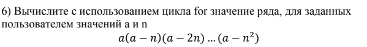
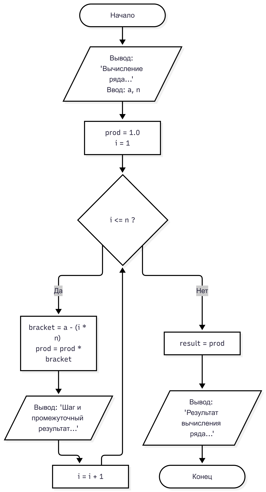

# Лабораторная работа № 7
## 1. Условие задачи, 6 Вариант
 

 

## 2. Реализация программы
```
#define _CRT_SECURE_NO_WARNINGS
#include <stdio.h>
#include <windows.h> // не работает #include <locale.h>

double calculate_series(double a, int n);
int main() {
    SetConsoleOutputCP(65001);
    double a;
    int n;
    printf("Вычисление ряда: a(a - n)(a - 2n) ... (a - n^2)\n\n");

    printf("Введите значение a: ");
    scanf("%lf", &a);

    printf("Введите значение n: ");
    scanf("%d", &n);

    double result = calculate_series(a, n);
    printf("\nРезультат вычисления ряда: %.4lf\n", result);
    return 0;
}


double calculate_series(double a, int n) {

    double prod = 1.0;
    for (int i = 1; i <= n; i = i + 1) {
        double bracket = a - (i * n);
        prod = prod * bracket;
        printf("Шаг %d: умножаем на (%.1lf - %d*%d) = %.1lf\n", i, a, i, n, bracket);
    }
    return prod;
}
```

## 3. Результаты работы программы

Вычисление ряда: a(a - n)(a - 2n) ... (a - n^2)

Введите значение a: 2
Введите значение n: 4
Шаг 1: умножаем на (2.0 - 1*4) = -2.0
Шаг 2: умножаем на (2.0 - 2*4) = -6.0
Шаг 3: умножаем на (2.0 - 3*4) = -10.0
Шаг 4: умножаем на (2.0 - 4*4) = -14.0

Результат вычисления ряда: 1680.0000

## 4. Информация о разработчике

 Воропаева Дарья БИД-261
